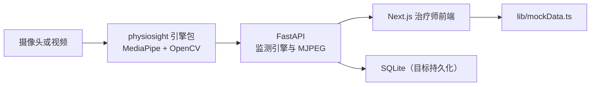
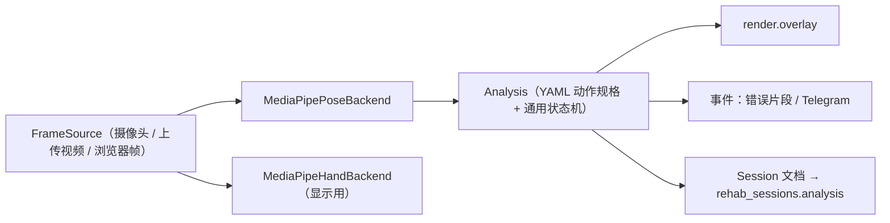
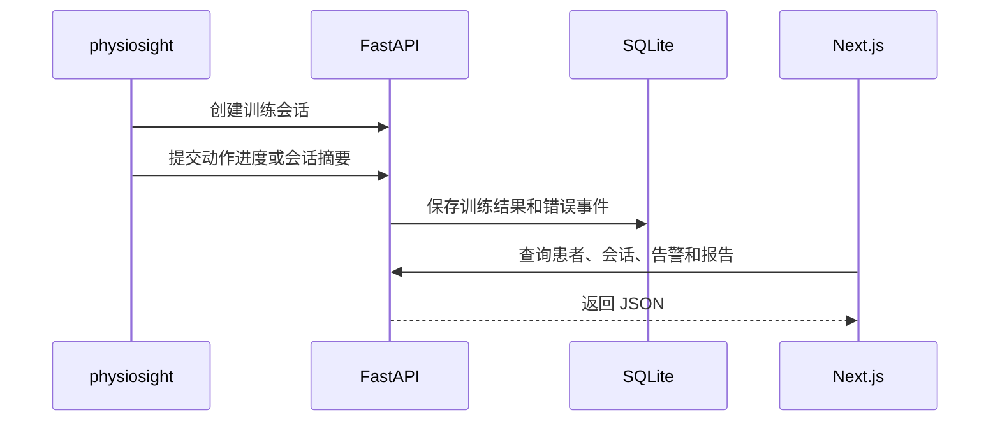

# PhysioVision 当前架构

**状态：核心功能实施基线**

本文描述仓库当前实际结构和近期实现边界。复杂的云端、医院系统和多 Agent 方案暂不作为核心依赖。

## 1. 当前组成



实时摄像头和上传视频分析已经接通。患者、报告等常规业务页面仍使用
Mock 数据，数据库业务闭环尚待完成。

## 2. 前端

前端原型保持现状，不进行视觉和页面结构重做。

```text
app/
├── (public)/
│   ├── page.tsx              /
│   ├── login/page.tsx        /login
│   └── register/page.tsx     /register
└── (app)/
    ├── dashboard/page.tsx    /dashboard
    ├── patients/page.tsx     /patients
    ├── exercises/page.tsx    /exercises
    ├── reports/page.tsx      /reports
    └── settings/page.tsx     /settings
```

患者、报告等数据目前来自 `lib/mockData.ts`。Live Session Monitor 已调用
FastAPI。后续业务集成应通过独立的数据访问层逐页替换 Mock。

## 3. 后端

FastAPI 入口为 `backend/main.py`。

```text
backend/app/
├── api/v1/endpoints/    HTTP 接口
├── models/              SQLAlchemy 数据模型
├── schemas/             请求和响应结构
├── services/            业务逻辑
├── agents/              规则分析原型
└── core/                配置、数据库、安全
```

当前已有患者、训练项目、会话、报告、告警、分析和诊所路由。部分 service、鉴权和 Agent 仍是占位实现；数据库自动建表也尚未启用。

核心后端只需要承担：

1. 患者和训练项目管理。
2. 接收本地监测程序产生的会话摘要。
3. 保存动作次数、质量状态、错误事件和录像引用。
4. 向前端提供查询接口。

## 4. 动作监测程序

动作分析由独立的 [`physiosight`](https://github.com/Wang-Tongfei/PhysioSight) 包完成，
后端以普通依赖安装，`backend/app/services/monitor_engine.py` 只负责任务管理、
浏览器帧源、MJPEG 推流、权限校验和持久化：



目前支持弯举、深蹲、平板支撑和俯卧撑（引擎另有肩前屈，平台尚未开放）。
分析按帧时间戳计时，浏览器约 10fps 的帧流与本地 30fps 的判定一致。
引擎也能脱离后端独立运行（`physiosight run`）。

## 5. 最小集成数据流



当前实时画面使用 MJPEG，因为它能直接传输 Bot 完成 HUD 绘制后的同一张
OpenCV 帧，适合单机或局域网原型。状态通过低频 REST 轮询获取。需要公网、
音频或多路低延迟视频时再升级为 WebRTC。

## 6. 暂不纳入核心范围

以下能力保留为未来选项，不应阻塞核心闭环：

- Redis Pub/Sub
- MinIO 或 S3
- PostgreSQL
- LangGraph 和外部大模型
- YOLO、ByteTrack 和多目标追踪
- Raspberry Pi 边缘节点集群
- FHIR、HL7 和医院 EMR 对接
- Kubernetes 或复杂云部署

错误视频初期可存放在本地 `clips/`，数据库使用 SQLite，分析优先采用现有确定性规则。

## 7. 完成标准

核心版本完成时应满足：

1. Bot 可以完成一种或多种训练动作分析。
2. Bot 能将会话结果可靠提交给 FastAPI。
3. FastAPI 能持久化并查询会话结果。
4. 现有前端页面能够显示真实患者、会话和告警数据。
5. 断开 Telegram 或外部 AI 服务时，核心训练流程仍可运行。

## 6. 改用 physiosight 包后的行为变化

迁移遵循引擎仓库的 `docs/PLATFORM_MIGRATION.md`；引擎自身的全部行为差异见其
`docs/BEHAVIOR_CHANGES.md`。对平台可见的变化：

| 变化 | 原因 / 影响 |
| --- | --- |
| 摄像头画面只在**显示**时镜像，分析使用原始帧 | 原来先镜像再估计姿态，弯举的左右手会颠倒（引擎 BC-4） |
| 判定按帧时间戳计时（浏览器帧用服务器接收时间） | 浏览器约 10fps 与本地 30fps 判定一致（引擎 BC-2）；上传视频用视频自身时间戳，不再受处理速度影响（BC-5） |
| 角度在像素坐标下计算 | 非正方形画面下角度不再失真（引擎 BC-1） |
| `rom_achieved_deg` 改为每次重复的屈曲峰值（取有效重复的中位数） | 原值是整段会话里实时角度的最大值减最小值，会混入准备阶段的数据；平板支撑仍取躯干线角度的平均值 |
| 新增 `rehab_sessions.analysis`（JSON）和 `GET /api/v1/sessions/{id}/analysis` | 保存引擎输出的完整 Session 文档（每次重复的结果、错误码、角度极值、视角是否合适），只对同一诊所可见 |
| 错误片段保存在 `backend/data/clips/`，录制的是遮住头部的渲染画面 | 原来保存在子模块目录，录的是原始画面 |
| 提示文字来自引擎的语言文件（英文），例如 `"Reps: 3/10"` | 原来是 `"Squat reps: 3/10"` 这类硬编码字符串 |

| `fatigue_index` 改为**组内速度损失**（%）：前两次有效重复中较快的一次为参照，与最后两次的平均角速度比较；角速度 = 屈曲幅度 ÷ 重复用时。有效重复少于 4 次或保持型动作（平板支撑）时为空，仪表盘显示 “—” | 原值是“有动作问题的帧占比”，并不衡量疲劳。速度损失是抗阻训练中公认的神经肌肉疲劳指标（Sánchez-Medina & González-Badillo, *Med Sci Sports Exerc* 2011;43(9):1725–1734）；单摄像头只能用关节角速度近似，**尚未在康复动作上验证** |

| `movement_quality_score` 改为由 Session 计算：70% 为有效重复占全部尝试的比例（保持型动作为计入时间占时长的比例），30% 为完成度 | 原来用“动作正常的帧占比”。改为按重复计算后，服务器监测和设备上传的 Session 使用同一定义（`app/services/session_records.py`） |

`coach_agent` / `risk_agent` 把空值的 `fatigue_index` 当作 0 处理。教练提示“建议休息”的阈值仍是
70%，对速度损失而言偏高（抗阻训练文献常用 20–40% 作为停止一组的阈值），需要结合真实数据重新设定。
